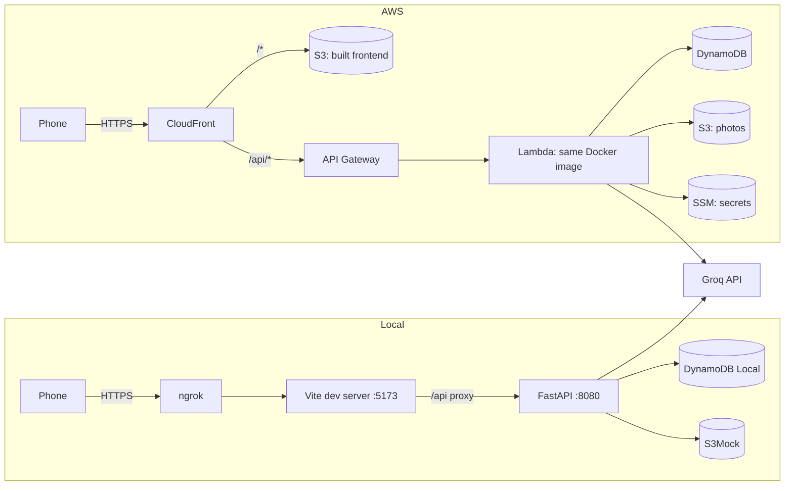
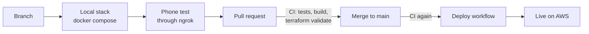

# Pantry

A mobile-first web app for a home pantry: log what you have, generate a grocery list from
what's running low, check things off in the store, and put groceries away in a few taps when
you get home. Snap a photo of a product and an AI model fills in its name, category and
expiry date.

**Live:** <https://d3bg4vze5d4ttm.cloudfront.net>. Tap **Continue** for a private demo
with a sample pantry. It resets after 24 hours and can't touch anyone else's data.

One household uses it for real (the owner logs in with a passcode); everyone else gets a
demo sandbox with the full experience, photo reading included.

- [How it's built](#how-its-built)
- [How a change gets to production](#how-a-change-gets-to-production)
- [Run it locally](#run-it-locally)
- [Test on a phone with ngrok](#test-on-a-phone-with-ngrok)
- [Tests and CI](#tests-and-ci)
- [Continuous deployment](#continuous-deployment)
- [AWS infrastructure](#aws-infrastructure)
- [Security and abuse limits](#security-and-abuse-limits)
- [Cost](#cost)
- [Repo map](#repo-map)

## How it's built

| Layer | Choice |
|---|---|
| Frontend | React 19, TypeScript, Vite, Tailwind v4, TanStack Query, Phosphor icons |
| Backend | Python 3.12, FastAPI, boto3, managed with [uv](https://docs.astral.sh/uv/) |
| Data | DynamoDB (one table), S3 for photos |
| Photo reading | Groq (`qwen/qwen3.8-27b`); OpenAI and Gemini also supported |
| Hosting | CloudFront, S3, API Gateway, Lambda (container image) on AWS |
| Infrastructure | Terraform, state in S3 |
| CI/CD | GitHub Actions, AWS access through OIDC (no stored keys) |
| Local dev | Docker Compose with DynamoDB Local and S3Mock; ngrok for phones |



The frontend and API share one origin (`/api`), so there's no CORS and the session is an
httpOnly cookie. The backend runs from **one Docker image** everywhere: Docker Compose runs
it with uvicorn, and on Lambda the [AWS Lambda Web Adapter](https://github.com/awslabs/aws-lambda-web-adapter)
forwards invocations to the same uvicorn process, so FastAPI runs unchanged.

## How a change gets to production



1. **Build on a branch** against the local stack, which hot-reloads.
2. **Try it on a real phone** through an ngrok tunnel, since this is a phone app first
   (camera, touch, small screens). Browser checks also run in a phone-sized Playwright window.
3. **Open a pull request.** CI runs backend and frontend tests, builds the Docker image and
   validates the Terraform.
4. **Merge.** CI runs again on `main`; when it passes, the Deploy workflow ships the code. A
   merge is the deploy, so nothing on a branch ever goes live by accident.

Infrastructure changes (anything in `infra/`) are the exception: they're reviewed with
`terraform plan` and applied by hand **before** merging the code that needs them. See
[Continuous deployment](#continuous-deployment) for why.

Work happens in small stages, each ending at that gate (tests, phone test, PR). The app is
built together with an AI coding agent; [AGENTS.md](AGENTS.md) is its working guide (status,
conventions, rules) and [docs/BACKLOG.md](docs/BACKLOG.md) holds open work.

## Run it locally

Needs Docker. Python and Node are only needed to run tests outside containers.

```sh
docker compose up -d --build
```

- App: <http://localhost:5173>
- API docs: <http://localhost:8080/api/docs>

Compose runs four containers: the API (uvicorn with reload), DynamoDB Local, S3Mock for photos,
and the Vite dev server. File changes are picked up by polling, because Docker on Windows
doesn't forward file events. Rebuild the API after changing Python dependencies
(`docker compose up -d --build api`).

### Owner passcode

Visitors always get a demo. To enable the owner login, set a 4-digit passcode once:

```sh
cd backend
uv run python ../scripts/set_passcode.py
docker compose up -d api
```

This writes `PASSCODE_HASH` (scrypt) and `SESSION_SECRET` to `backend/.env`, which is
git-ignored. The passcode itself is never stored.

### Photo reading

Add one provider's key to `backend/.env`, then `docker compose up -d api`. The first key
found wins:

```sh
GROQ_API_KEY='gsk_...'         # qwen/qwen3.8-27b (override with GROQ_MODEL)
OPENAI_API_KEY='sk-...'        # gpt-6-luna (OPENAI_MODEL)
GEMINI_API_KEY='...'           # gemini-3.8-flash (GEMINI_MODEL)
```

Tests never call a real model.

### Tutorial clips

The welcome screen shows short clips recorded from the real app in a throwaway demo with the
sample pantry. Re-record them after UI changes:

```sh
cd frontend
npx playwright install chromium   # once
npm run record-tutorials          # stack running, ffmpeg on PATH
```

## Test on a phone with ngrok

The phone needs HTTPS for the camera, and the app has to be reachable from outside your
network. [ngrok](https://ngrok.com/) does both by tunnelling to the Vite dev server:

```sh
ngrok http 5173
```

Open the `https://….ngrok-free.app` (or your static ngrok domain) on the phone. Vite proxies
`/api` to the API container, so the whole app works through that one URL, with hot reload.

- **Use a demo session** for testing. The local database may hold real data.
- **Stop ngrok when you're done.** It exposes your laptop's copy of the app, owner login
  included, to the internet.
- ngrok is for testing changes only. The real app lives on AWS.

## Tests and CI

```sh
cd backend && uv run pytest -q      # ~100 tests, AWS mocked with moto
cd frontend && npm test             # ~50 vitest tests (pure logic: search, sort, dates, packages)
cd frontend && npm run build        # typecheck + production build
```

[`.github/workflows/ci.yml`](.github/workflows/ci.yml) runs on every pull request and every
push to `main`:

| Job | What it checks |
|---|---|
| backend | `uv sync --frozen`, pytest (DynamoDB, S3 and SSM mocked with moto) |
| frontend | `npm ci`, vitest, typecheck and build |
| docker | the API image builds (`app` stage) |
| terraform | `terraform fmt -check`, `init -backend=false`, `validate` (no AWS access needed) |

## Continuous deployment

[`.github/workflows/deploy.yml`](.github/workflows/deploy.yml) runs when **CI succeeds for a
push to `main`** (a merge). It can also be started by hand ("Run workflow" in the Actions tab).
Deploys run one at a time, in order.

Steps:

1. Log in to AWS with **OIDC**, then to ECR, including public ECR for the Lambda Web Adapter
   layer (anonymous pulls from CI runners get rate-limited).
2. Build the Lambda image and push it as `:latest` and `:<commit sha>`.
3. Point Lambda at the new image's **digest** and wait for the update.
4. Build the frontend and upload it with
   [`scripts/upload_frontend.sh`](scripts/upload_frontend.sh): hashed bundles get a one-year
   immutable cache, `index.html` gets `no-cache`, and CloudFront is invalidated.
5. Check `/api/health` through CloudFront.

**No AWS keys live in GitHub.** GitHub issues the workflow a short-lived identity token, and
AWS exchanges it for temporary credentials of the `pantry-github-deploy` role
([`infra/github.tf`](infra/github.tf)):

- Only workflows on `main` of this repository can assume it. The trust policy matches GitHub's
  *immutable* subject (`repo:owner@ownerId/repo@repoId:ref:refs/heads/main`), so a deleted and
  re-created repo with the same name can't match.
- It can only push to the image repository, update the Lambda's code, write to the frontend
  bucket and invalidate CloudFront. It can't read data or secrets, or change infrastructure or
  IAM.

**Why Terraform isn't applied by the pipeline:** infrastructure changes can delete or replace
the database, buckets or permissions, so each one is planned, reviewed by a person and applied
locally. Code deploys are routine and fully automatic. The two paths stay in sync because
Terraform pins Lambda to the digest of `:latest`, the same image the workflow deploys, so
`terraform plan` shows no changes after a code deploy.

### Manual deploy

[`scripts/deploy.sh`](scripts/deploy.sh) (Git Bash) does everything from a laptop: build and
push the image, `terraform apply` (with its usual approval prompt), build and upload the
frontend. Use it for infrastructure changes or if GitHub Actions is unavailable.

### First-time setup (new AWS account)

Needs the AWS CLI with a named profile (`pantry`, region `us-east-1`), Terraform and Docker.

```sh
terraform -chdir=infra/bootstrap init && terraform -chdir=infra/bootstrap apply  # state bucket
(cd backend && uv run python ../scripts/set_aws_secrets.py)                       # secrets
scripts/deploy.sh                                                                 # everything else
```

`set_aws_secrets.py` copies the passcode hash and Groq key from `backend/.env` into SSM
Parameter Store as SecureStrings, generates a fresh session secret, never prints anything,
and restarts the API so it picks up the new values. Re-run it whenever a key changes.

## AWS infrastructure

All in Terraform under [`infra/`](infra/), with state in a versioned S3 bucket created by
[`infra/bootstrap/`](infra/bootstrap/) (S3-native locking, no lock table).

| File | Resources |
|---|---|
| `data.tf` | DynamoDB table (on demand, TTL, point-in-time recovery, deletion protection); photos bucket with a lifecycle rule that deletes demo photos after 2 days |
| `api.tf` | ECR repository (keeps the last 5 images), Lambda (container image, 1 GB, 30 s), HTTP API with throttling, IAM role with least privilege, log group |
| `web.tf` | Private frontend bucket (CloudFront origin access control), CloudFront distribution with security headers |
| `github.tf` | GitHub OIDC provider and the deploy role |

- **CloudFront** serves `/*` from S3 and sends `/api/*` to API Gateway with caching off, using
  the `AllViewerExceptHostHeader` policy. That forwards cookies and the
  `CloudFront-Viewer-Address` header, which per-IP rate limits use.
- **Secrets** (passcode hash, session secret, Groq key) are SSM SecureStrings under `/pantry/`.
  Terraform never sees them. The API loads them at cold start
  ([`backend/app/ssm.py`](backend/app/ssm.py)) and refuses to start on Lambda without a
  session secret, so it can't fall back to the development one.
- **Data:** one DynamoDB table holds both the real pantry (`SPACE#main`) and the demo sandboxes
  (`SPACE#sb-<expiry>-<id>`). Every demo row carries a TTL, so DynamoDB deletes a whole demo
  when it expires. The table and photo bucket are protected from `terraform destroy`.

## Security and abuse limits

- **Demo isolation:** a visitor's session is bound to their own sandbox; they can read the
  owner's photos (their demo is a copy) but only write in their own space.
- **CloudFront-only API:** CloudFront adds a random `X-Origin-Verify` header (generated by
  Terraform) and the API returns 403 without it. Nobody can call API Gateway directly and spoof
  the viewer-address header.
- **Owner login:** 4-digit passcode stored as an scrypt hash; 5 wrong attempts per IP per 15
  minutes, 20 per hour overall.
- **Rate limits** use DynamoDB counters, so they hold across Lambda instances:
  - demos: 20 per hour per IP, 500 per hour overall
  - photo uploads: 40 per demo per day
  - photo reading: 20 per demo and 300 for the owner per day, 1,000 per day overall
  - API Gateway throttle: 20 requests per second (burst 50)
- **Secrets** (passcode hash, session secret, model keys) never appear in the repo, Terraform
  state, logs or CI. The only Terraform-held secret is the CloudFront origin header, which lives
  in the private, encrypted state bucket and the Lambda's settings.

## Cost

At one household's usage this costs well under $1 a month on AWS. CloudFront, Lambda and
DynamoDB storage fit in their always-free tiers; API Gateway, S3 and ECR come to cents.
Photo reading is billed by Groq per token, a fraction of a cent per photo. The daily caps
above bound the worst case.

## Repo map

```
backend/                 FastAPI app (app/), pytest suite (tests/), Dockerfile (app + lambda stages)
frontend/                React app (src/), tutorial recorder (scripts/), clips (public/tutorials/)
infra/                   Terraform for AWS; infra/bootstrap/ for the state bucket
scripts/                 set_passcode.py, set_aws_secrets.py, deploy.sh, upload_frontend.sh
.github/workflows/       ci.yml (tests on every PR and push), deploy.yml (deploy after CI on main)
docker-compose.yml       local stack: API, DynamoDB Local, S3Mock, Vite
AGENTS.md                working guide: status, conventions, rules, gotchas
docs/BACKLOG.md          open work and ideas
```
